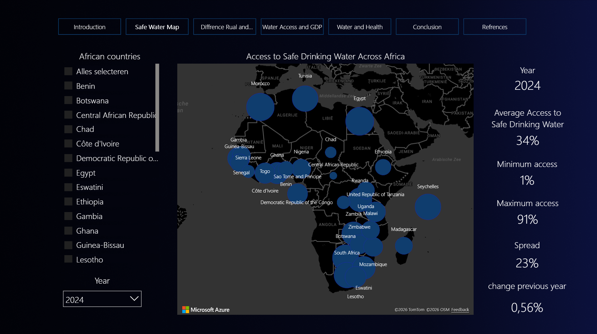

# Safe Water & Economic Development

**An interactive Power BI dashboard exploring safe drinking water, economic development and health across African countries.**

Created by **Lucan den Dekker** for the first-year Introduction to Data Science block of Applied Data Science & AI at Breda University of Applied Sciences.

## Explore the dashboard

**[Try the dashboard in my portfolio](https://lucandendekker.nl/portfolio/power-bi-dashboard/)**

[Open the interactive Power BI report](https://app.powerbi.com/view?r=eyJrIjoiYzZiMjc1NGUtODc1Zi00N2I1LWJiOGEtY2UzZmVhMTNiNzkyIiwidCI6IjBhMzM1ODliLTAwMzYtNGZlOC1hODI5LTNlZDA5MjZhZjg4NiIsImMiOjl9) | [Download the Power BI file](dashboard/sdg-water-dashboard.pbix)



## Research question

How has access to safely managed drinking water changed across African countries, and how does it relate to urban-rural inequality, GDP per capita and access to health services?

The project centres on **SDG 6: Clean Water and Sanitation**, with connections to **SDG 8: Decent Work and Economic Growth** and **SDG 3: Good Health and Well-Being**. The dashboard is intended to help policymakers, researchers and interested readers explore these relationships.

## What I did

- Framed the research question and stakeholder needs using CRISP-DM.
- Selected country-level data from the UN SDG database and World Bank.
- Prepared data in Power Query: promoted headers, selected African countries, unpivoted year columns, merged queries and set data types.
- Connected country and year tables for interactive filtering.
- Created DAX measures for average, minimum, maximum, standard deviation and change from the previous available year.
- Designed a multi-page report with maps, comparisons, trends and navigation.

## Explore seven report pages

| Page | Purpose |
|---|---|
| Introduction | Research context and navigation |
| Safe Water Map | Geographic differences in access |
| Urban vs Rural | Differences between population groups |
| Water Access and GDP | Water access alongside GDP per capita |
| Water and Health | Water access alongside health-service coverage |
| Conclusion | Summary of the project findings |
| References | Data sources |

## Data and scope

The included PBIX was inspected directly. Its core tables contain:

| Table | Rows | Observed year range |
|---|---:|---|
| Access to safe water | 2,091 | 2000-2024 |
| GDP African countries | 1,068 | 2000-2024 |
| Health index Africa | 350 | 2000-2021 |

The health table contains the imported universal health coverage indicator, not a clinical health score. These date ranges describe the model's stored observations; not every country has observations in every year.

Sources recorded in the model and project documentation:

- [UN SDG Data Portal](https://unstats.un.org/sdgs/dataportal/database): safely managed drinking water and universal health coverage indicators.
- [World Bank: GDP per capita, current US$](https://data.worldbank.org/indicator/NY.GDP.PCAP.CD).

These are aggregate country-level statistics. Source data retain their respective providers' terms and attribution.

## Technical files

```text
dashboard/sdg-water-dashboard.pbix   Original Power BI report and embedded model
images/dashboard.png               Portfolio preview image
power-query/*.pq                    Five extracted M queries
dax/measures.dax                    Seven extracted DAX measures
docs/model-schema.json             Table and column inventory
docs/report-pages.json             Original page names and visual counts
docs/project-notes.md              Interpretation and limitations
```

The M and DAX exports make the modelling work readable on GitHub. Local source paths in the exported M queries are replaced with `data/<filename>` placeholders. The original PBIX is preserved, so its refresh connections still reference the original local Excel files.

## Open locally

1. Download `dashboard/sdg-water-dashboard.pbix`.
2. Open it in a recent version of **Power BI Desktop on Windows**.
3. Explore the stored report and data without refreshing.
4. To refresh, download the source datasets and update the source locations in Power Query / Data source settings. The original Excel extracts are not included here.

The online report can be explored without installing Power BI Desktop. This repository is a dashboard case study, not a Python application.

## Interpretation

The report explores geographic inequality, urban-rural differences and associations with economic development and health-service coverage. Correlations and parallel trends do **not** establish causation. Comparisons also depend on year availability, country selection, population grouping and aggregation choices. See [project notes](docs/project-notes.md).

## Validation

The PBIX archive, report layout and stored model were read successfully. Table sizes, year ranges, DAX and Power Query exports were checked against the file. Desktop rendering and a complete refresh from the original Excel sources have not been retested.
